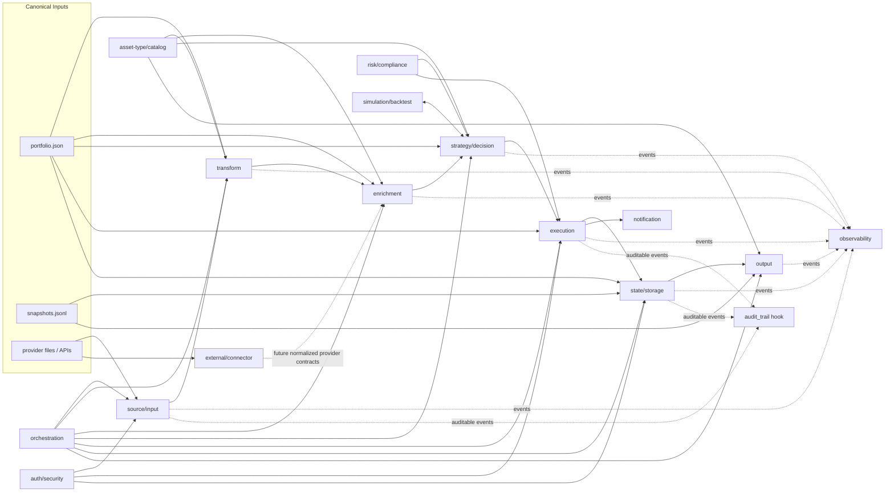

# Plugin Architecture

Rikdom's extensibility model is built on [Pluggy](https://pluggy.readthedocs.io/).
This document explains the moving parts and why they are shaped the way they
are. For field-level facts see the [plugin manifest](../reference/plugin-manifest.md)
and [plugin hooks](../reference/plugin-hooks.md) references; for a guided walkthrough
see [Author your first plugin](../tutorials/first-plugin.md).

## What a plugin is

A plugin is a Python class discovered from `plugins/<plugin-name>/plugin.json`
and loaded into the Pluggy runtime. Rikdom resolves:

- manifest: `plugins/<plugin-name>/plugin.json`
- module file: `plugins/<plugin-name>/<module>.py`
- class: `<class_name>` inside that module

The runtime is built in:

- `src/rikdom/plugin_engine/manifest.py`
- `src/rikdom/plugin_engine/loader.py`
- `src/rikdom/plugin_engine/runtime.py`
- `src/rikdom/plugin_engine/hookspecs.py`
- `src/rikdom/plugin_engine/pipeline.py`

There is no subprocess-based plugin contract. The manifest schema rejects any
field outside the Pluggy set, so a plugin must expose a Python class that
registers `@hookimpl` methods.

## Lifecycle

## Plugin taxonomy

`PhaseName` (`src/rikdom/plugin_engine/contracts.py`) is the source of truth
for the categories below. Not all are wired into CLI entrypoints yet — the
[plugin hooks reference](../reference/plugin-hooks.md) tracks which hookspecs
are live.

| Plugin type | Lifecycle role | Typical input | Expected output |
| --- | --- | --- | --- |
| `source/input` | Ingest external statements into normalized rikdom payloads | File path or remote payload | Normalized dict with holdings/events for merge |
| `external/connector` | Explicit read-only acquisition outside the canonical lifecycle | Declared operation + JSON parameters | Raw provider dict, wrapped by host acquisition provenance |
| `transform` | Normalize/reshape portfolio data before advanced processing | Canonical portfolio + imported payloads | Transformed canonical structures |
| `enrichment` | Planned normalization of prices, FX, events, and instrument metadata | Dated provider facts + instrument mappings | Typed series/events with provenance and coverage |
| `strategy/decision` | Turn data into allocation/rebalance decisions | Portfolio, snapshots, constraints | Decision set (target weights, deltas, actions) |
| `execution` | Convert decisions into executable intents/events | Decision set + policies | Execution plan or ledger-ready events |
| `output` | Render reports/dashboards/exports | Canonical files + options | Artifact list and metadata |
| `risk/compliance` | Evaluate risk/compliance gates before execution | Portfolio, exposures, decision set | Findings, blocked/allowed actions |
| `state/storage` | Mirror/query canonical state in a storage backend | Canonical files + options | Sync/query/health payloads |
| `orchestration` | Coordinate phase execution order, retries, schedules | Pipeline context + run policies | Run plans / execution graph |
| `observability` | Emit logs/metrics/traces for plugin runs | Event name + payload + run context | (Side effect) |
| `auth/security` | Authorize plugin actions and redact sensitive fields | Action context + principal | Allow/deny + filtered payloads |
| `notification` | Notify users/systems about run outcomes | Run outcome payloads | Delivery result records |
| `simulation/backtest` | Run what-if and historical simulations | Strategy rules + historical snapshots | Backtest results/metrics |
| `asset-type/catalog` | Extend domain model with asset-type definitions | Context only | List of asset type definitions |

## Dispatch semantics

- **`firstresult=True`** hooks select one plugin result. Use one active plugin
  per run for these phases: `source_input`, `output`, `state_storage_sync`,
  `state_storage_query`, `state_storage_health`, `connector_describe`,
  `connector_query`.
- **Fan-out** hooks collect from all registered plugins:
  `asset_type_catalog` (merged by `id`), `observability`, `audit_trail`.
- `audit_trail` is a cross-cutting hook for auditable events.

The `firstresult` boundary keeps imports and writes deterministic — exactly
one plugin owns the result. The fan-out boundary is reserved for additive,
side-effect-or-merge surfaces where having many plugins compose makes sense.

## External connectors

An external connector keeps a service's operations, credentials, and transport
inside its plugin. Core exposes `connector describe` and `connector query`,
validates the versioned capability description, and dispatches one advertised
operation with detached JSON parameters to the selected plugin. A provider can
add operations without adding provider-specific CLI
commands or dependencies to core. The two connector hooks are Experimental,
additive extensions in plugin API `1.1`. Existing `1.0` plugins and Stable hook
contracts remain unchanged.

REST APIs and MCP servers can fit this same boundary: a plugin owns its HTTP
client or MCP client and returns a JSON dict. The
[brapi plugin](../../plugins/brapi/README.md) is an example external data
connector. No concrete MCP transport is implemented yet.

Provider responses remain provider-native, including missing values, warnings,
and error fields. Market quotes and declared dividends describe external market
facts; they do not establish a user's holdings, balances, or received cash flows.
An FII indicator with a `null` value is unknown, not zero. Queries therefore do
not enter the statement import pipeline, change canonical files, or replace
the existing FX provider.

This boundary is the first connector query surface. Normalized enrichment,
provider contracts for prices/FX/events, cached replay, permission enforcement,
and sandboxing remain future work. `external/connector` describes acquisition,
not a replacement lifecycle stage for `enrichment`: a transport may return
provider-native facts, while a later enrichment contract must turn those facts
into the normalized, dated inputs consumed by deterministic calculations.
A plugin may eventually implement both capabilities without teaching core
about a country, service, HTTP endpoint, or MCP tool name.

The host wraps query results with the connector contract version, plugin name
and implementation/API versions, operation, and UTC retrieval time. Raw fields
remain under `data`. This preserves acquisition evidence without treating an
API response as a normalized financial record. Request parameters are not
automatically echoed into artifacts; callers must keep credentials in the
provider's designated credential channel. The envelope is documented in the
[hook reference](../reference/plugin-hooks.md#connector-hooks).

### Roadmap alignment and remaining work

This foundation supports the roadmap's explicit optional connections, global
plugin ownership, and separation from the immutable canonical ledger. It does
not complete Phase 5 or the connected-automation gate in Phase 5B.

| Boundary | Implemented now | Still required by the roadmap |
| --- | --- | --- |
| Acquisition | Selected connector; validated offline capabilities; provider-owned transport/auth; raw JSON with plugin/version and retrieval provenance | Coverage/license inventory and maintained regional reference packs |
| Financial meaning | Raw provider facts kept outside canonical holdings and activities | Normalized prices, FX, distributions, and corporate actions with instrument identity, effective timestamps, currency, adjustments, coverage, and licensing |
| Reproducibility | Strict detached JSON; deterministic offline fixtures and mocked transport tests | Versioned cache inputs, safe request provenance, stale/missing-series diagnostics, replay, and traceable idempotent corrections |
| Trust | Explicit manual query; no portfolio paths passed by the connector pipeline; read-only declaration | Enforced network/filesystem/secret scopes, credential revocation, OS-backed secret storage, constrained execution, and unattended-connection safeguards |

The legacy Frankfurter integration in `src/rikdom/fx.py` remains coupled to the
existing FX ingestion workflow. It is not used by the connector pipeline.
Moving that workflow behind normalized provider contracts is follow-up work;
this addition makes the new connector boundary provider-neutral, not every
existing provider path in the repository.

## Operational safety

Plugin code is trusted Python loaded in-process with the user's filesystem,
environment, network, and execution privileges. Importing a plugin can execute
arbitrary code before any hook is called, including during `connector describe`.
The offline descriptor and `readOnly` flag are author contracts, not access
controls. No current manifest field or hook can restrain that code.

`connector query --plugin NAME` explicitly opts into the selected plugin's
request; ordinary import/report workflows do not automatically call connectors.
The host passes only the supplied operation/parameters, without loading or
uploading portfolio contents. Plugins must implement minimum identifier/date
requests, scoped authentication, and redacted diagnostics. REST versus MCP
does not change the local Python trust boundary. Only install and load code
you trust; constrained execution and connected scheduling remain gated by
Phase 5B. Plugin authors are also responsible for:

- Validating paths/options before file or DB writes.
- Avoiding shell execution when a direct library call exists.
- Returning actionable error messages for missing dependencies.
- Emitting warnings for degraded/fallback modes.

## Determinism contract

Every Pluggy plugin that declares a v1 data hook must ship at least one
contract-test fixture. The runner in
`src/rikdom/plugin_engine/contract_runner.py` invokes each hook twice in fresh
tmpdirs and asserts byte-identical canonical JSON. See
[`reference/plugin-hooks.md`](../reference/plugin-hooks.md#contract-test-fixtures)
for the fixture layout.

The reasoning: normalized plugin output can flow into long-lived JSON state,
where unexpected nondeterminism makes diffs unreviewable. Live connector data
and host retrieval timestamps naturally change. Connector fixtures exercise
offline descriptions and query results through the shared validator; they
compare the raw data before the host adds acquisition time. This does not
claim live market-data determinism or offline provider-cache replay.

## See also

- [Plugin compatibility & stability](plugin-compatibility.md) — `api_version` policy.
- [Plugin manifest reference](../reference/plugin-manifest.md)
- [Plugin hooks reference](../reference/plugin-hooks.md)
- [Author your first plugin tutorial](../tutorials/first-plugin.md)

## Calculation and source boundaries

Source plugins own file layouts, locale/date/timezone parsing, institutional account
mapping, source-event interpretation, and identity evidence construction. They emit
normalized facts without reading portfolio state. Core validates contracts, compares
opaque identities/scopes, enforces ledger/reference integrity, persists provenance,
and performs deterministic calculations. Output plugins own labels, language, layout,
and grouping while consuming core valuation/trust results. User selections and
preferences remain portfolio/policy data, not per-user branches in core.

The optional Frankfurter connector illustrates provider isolation: HTTP operations
live in `plugins/frankfurter`; core selects cached FX history and only acquires data
through an explicitly injected provider. Import diagnostics, reconciliation and
report generation keep acquisition disabled.

The shared parsing primitives require explicit source conventions:
`parse_decimal(..., decimal_separator=..., grouping_separator=...)` and
`normalize_datetime(..., naive_timezone=..., date_formats=...)`. Source plugins
remove their own currency decorations and choose ambiguous date ordering; core
preflight validates normalized JSON numbers and timezone-aware ISO timestamps.
The stable `source_input` hook signature is unchanged.
