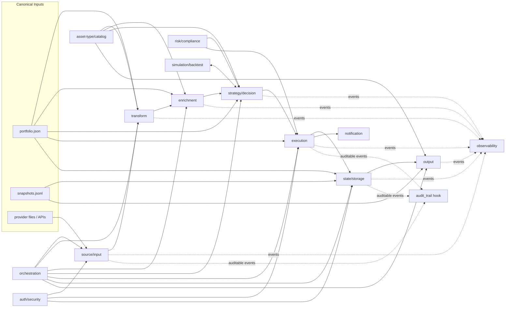

# Plugin Architecture

Rikdom's extensibility model is built on [Pluggy](https://pluggy.readthedocs.io/).
This document explains the moving parts and why they are shaped the way they
are. For field-level facts see the [plugin manifest](../reference/plugin-manifest.md)
and [plugin hooks](../reference/plugin-hooks.md) references; for a guided walkthrough
see [Author your first plugin](../tutorials/first-plugin.md).

## What a plugin is

A plugin is a Python class discovered from `plugins/<plugin-name>/plugin.json`
and loaded into the Pluggy runtime. Rikdom resolves:

- manifest: `plugins/<plugin-name>/plugin.json`
- module file: `plugins/<plugin-name>/<module>.py`
- class: `<class_name>` inside that module

The runtime is built in:

- `src/rikdom/plugin_engine/manifest.py`
- `src/rikdom/plugin_engine/loader.py`
- `src/rikdom/plugin_engine/runtime.py`
- `src/rikdom/plugin_engine/hookspecs.py`
- `src/rikdom/plugin_engine/pipeline.py`

There is no subprocess-based plugin contract. The manifest schema rejects any
field outside the Pluggy set, so a plugin must expose a Python class that
registers `@hookimpl` methods.

## Lifecycle

## Plugin taxonomy

`PhaseName` (`src/rikdom/plugin_engine/contracts.py`) is the source of truth
for the categories below. Not all are wired into CLI entrypoints yet — the
[plugin hooks reference](../reference/plugin-hooks.md) tracks which hookspecs
are live.

| Plugin type | Lifecycle role | Typical input | Expected output |
| --- | --- | --- | --- |
| `source/input` | Ingest external statements into normalized rikdom payloads | File path or remote payload | Normalized dict with holdings/events for merge |
| `transform` | Normalize/reshape portfolio data before advanced processing | Canonical portfolio + imported payloads | Transformed canonical structures |
| `enrichment` | Add metadata (issuer, sector, indexer, benchmark, FX context) | Canonical holdings/catalog | Enriched holdings or metadata blobs |
| `strategy/decision` | Turn data into allocation/rebalance decisions | Portfolio, snapshots, constraints | Decision set (target weights, deltas, actions) |
| `execution` | Convert decisions into executable intents/events | Decision set + policies | Execution plan or ledger-ready events |
| `output` | Render reports/dashboards/exports | Canonical files + options | Artifact list and metadata |
| `risk/compliance` | Evaluate risk/compliance gates before execution | Portfolio, exposures, decision set | Findings, blocked/allowed actions |
| `state/storage` | Mirror/query canonical state in a storage backend | Canonical files + options | Sync/query/health payloads |
| `orchestration` | Coordinate phase execution order, retries, schedules | Pipeline context + run policies | Run plans / execution graph |
| `observability` | Emit logs/metrics/traces for plugin runs | Event name + payload + run context | (Side effect) |
| `auth/security` | Authorize plugin actions and redact sensitive fields | Action context + principal | Allow/deny + filtered payloads |
| `notification` | Notify users/systems about run outcomes | Run outcome payloads | Delivery result records |
| `simulation/backtest` | Run what-if and historical simulations | Strategy rules + historical snapshots | Backtest results/metrics |
| `asset-type/catalog` | Extend domain model with asset-type definitions | Context only | List of asset type definitions |

## Dispatch semantics

- **`firstresult=True`** hooks select one plugin result. Use one active plugin
  per run for these phases: `source_input`, `output`, `state_storage_sync`,
  `state_storage_query`, `state_storage_health`.
- **Fan-out** hooks collect from all registered plugins:
  `asset_type_catalog` (merged by `id`), `observability`, `audit_trail`.
- `audit_trail` is a cross-cutting hook for auditable events.

The `firstresult` boundary keeps imports and writes deterministic — exactly
one plugin owns the result. The fan-out boundary is reserved for additive,
side-effect-or-merge surfaces where having many plugins compose makes sense.

## Operational safety

Plugin code is trusted local code with potential side effects. The engine
deliberately avoids sandboxing: it leaves you in control of which plugins
exist on disk. The trade-off is that authors are responsible for:

- Validating paths/options before file or DB writes.
- Avoiding shell execution when a direct library call exists.
- Returning actionable error messages for missing dependencies.
- Emitting warnings for degraded/fallback modes.

## Determinism contract

Every Pluggy plugin that declares a v1 data hook must ship at least one
contract-test fixture. The runner in
`src/rikdom/plugin_engine/contract_runner.py` invokes each hook twice in fresh
tmpdirs and asserts byte-identical canonical JSON. See
[`reference/plugin-hooks.md`](../reference/plugin-hooks.md#contract-test-fixtures)
for the fixture layout.

The reasoning: plugin output flows into long-lived JSON state. A non-deterministic
plugin would silently corrupt round-trip equality and make diffs unreviewable.

## See also

- [Plugin compatibility & stability](plugin-compatibility.md) — `api_version` policy.
- [Plugin manifest reference](../reference/plugin-manifest.md)
- [Plugin hooks reference](../reference/plugin-hooks.md)
- [Author your first plugin tutorial](../tutorials/first-plugin.md)
