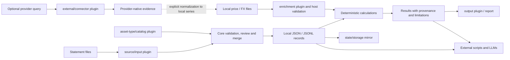

# Plugin Architecture

Rikdom's extensibility model is built on [Pluggy](https://pluggy.readthedocs.io/).
This document explains the moving parts and why they are shaped the way they
are. For field-level facts see the [plugin manifest](../reference/plugin-manifest.md)
and [plugin hooks](../reference/plugin-hooks.md) references; for a guided walkthrough
see [Author your first plugin](../tutorials/first-plugin.md).

## What a plugin is

A plugin is a Python class discovered from `plugins/<plugin-name>/plugin.json`
and loaded into the Pluggy runtime. Rikdom resolves:

- manifest: `plugins/<plugin-name>/plugin.json`
- module file: `plugins/<plugin-name>/<module>.py`
- class: `<class_name>` inside that module

The runtime is built in:

- `src/rikdom/plugin_engine/manifest.py`
- `src/rikdom/plugin_engine/loader.py`
- `src/rikdom/plugin_engine/runtime.py`
- `src/rikdom/plugin_engine/hookspecs.py`
- `src/rikdom/plugin_engine/pipeline.py`

There is no subprocess-based plugin contract. The manifest schema rejects any
field outside the Pluggy set, so a plugin must expose a Python class that
registers `@hookimpl` methods.

## Core and extension flow

The engine supports bounded input, enrichment, output, and storage contracts.
Investment decisions and application services belong to independent consumers;
see [product scope and extension ownership](product-scope.md).

These arrows describe data boundaries, not an automatically scheduled pipeline.
Acquisition and normalization are explicit; plugins do not acquire permission
from a diagram or manifest category. Accepted changes use validated write paths.

## Plugin categories and supported hooks

`PhaseName` (`src/rikdom/plugin_engine/contracts.py`) defines the accepted category
vocabulary. The [hooks reference](../reference/plugin-hooks.md) defines actual
runtime capabilities and stability; categories alone do not create hooks.

| Category | Supported role | Boundary |
| --- | --- | --- |
| `source/input` | Normalize statements | Core validates and merges supplied facts. |
| `external/connector` | Explicit read-only provider queries | Plugin owns operations, transport, authentication, and provider dependencies. |
| `enrichment` | Normalized local price/FX series and historical lookups | API 1.2 contract; core validates dated inputs and lookup results. |
| `asset-type/catalog` | Supply typed asset definitions | Regional definitions stay in catalogs. |
| `output` | Render reports or exports | Layout, labels, and presentation dependencies stay in the plugin. |
| `state/storage` | Mirror/query canonical files | Query backends do not replace canonical JSON/JSONL. |
| `observability` / audit hooks | Emit runtime and audit events | Hooks describe events; they do not implement a monitoring service. |

Other accepted labels include `transform`, `strategy/decision`, `execution`,
`risk/compliance`, `orchestration`, `auth/security`, `notification`, and
`simulation/backtest`. They are classification vocabulary, not a promised core
lifecycle or backlog. Extension libraries can consume files and Python APIs
without adding hooks. Any new core hook needs a demonstrated records, validation,
or shared calculation requirement and a versioned behavioral contract.

## Dispatch semantics

- **`firstresult=True`** hooks select one plugin result. Use one active plugin
  per run for these phases: `source_input`, `output`, `state_storage_sync`,
  `state_storage_query`, `state_storage_health`, `connector_describe`,
  `connector_query`, `enrichment`.
- **Fan-out** hooks collect from all registered plugins:
  `asset_type_catalog` (merged by `id`), `observability`, `audit_trail`.
- `audit_trail` is a cross-cutting hook for auditable events.

The `firstresult` boundary keeps imports and writes deterministic — exactly
one plugin owns the result. The fan-out boundary is reserved for additive,
side-effect-or-merge surfaces where having many plugins compose makes sense.

## External connectors

An external connector keeps a service's operations, credentials, and transport
inside its plugin. Core exposes `connector describe` and `connector query`,
validates the versioned capability description, and dispatches one advertised
operation with detached JSON parameters to the selected plugin. A provider can
add operations without adding provider-specific CLI
commands or dependencies to core. The two connector hooks are Experimental,
additive extensions in plugin API `1.1`. Existing `1.0` plugins and Stable hook
contracts remain unchanged.

REST APIs and MCP servers can fit this same boundary: a plugin owns its HTTP
client or MCP client and returns a JSON dict. The
[brapi plugin](../../plugins/brapi/README.md) is an example external data
connector. No concrete MCP transport is implemented yet.

Provider responses remain provider-native, including missing values, warnings,
and error fields. Market quotes and declared dividends describe external market
facts; they do not establish a user's holdings, balances, or received cash flows.
An FII indicator with a `null` value is unknown, not zero. Queries therefore do
not enter the statement import pipeline, change canonical files, or replace
the existing FX provider.

`external/connector` describes acquisition. The separate
[enrichment contract](../reference/enrichment.md) validates normalized local
price/FX series for historical lookup and calculation. A provider adapter can
implement both boundaries while keeping country, service, HTTP endpoint, and
MCP transport knowledge outside core. Raw connector JSON is not automatically
converted into these inputs or canonical portfolio records.

The host wraps query results with the connector contract version, plugin name
and implementation/API versions, operation, and UTC retrieval time. Raw fields
remain under `data`. This preserves acquisition evidence without treating an
API response as a normalized financial record. Request parameters are not
automatically echoed into artifacts; callers must keep credentials in the
provider's designated credential channel. The envelope is documented in the
[hook reference](../reference/plugin-hooks.md#connector-hooks).

### Ownership of acquisition and financial meaning

Provider plugins own supported markets/assets, acquisition costs and quotas,
licenses, authentication, and coverage documentation. Core owns normalized-input
validation and deterministic calculations over explicitly selected local data.

Local [market series](../reference/market-series.md),
[reviewed market events](../reference/market-events.md), and
[historical valuation](../reference/historical-valuation.md) describe separate
financial contracts. External announcements do not establish user receipts or
entitlements. [Captured analysis](../how-to/capture-and-replay-analysis.md)
preserves selected normalized inputs and results without re-running providers.

Snapshot FX acquisition uses the same connector boundary: explicit
`--fx-provider frankfurter` selects the provider plugin. Core
`src/rikdom/fx.py` handles local history and FX locks without provider HTTP code.
Importer re-execution and provider-cache acquisition remain adapter/tooling
responsibilities, rather than prerequisites for calculation replay.

## Operational safety

Plugin code is trusted Python loaded in-process with the user's filesystem,
environment, network, and execution privileges. Importing a plugin can execute
arbitrary code before any hook is called, including during `connector describe`.
The offline descriptor and `readOnly` flag are author contracts, not access
controls. No current manifest field or hook can restrain that code.

`connector query --plugin NAME` explicitly opts into the selected plugin's
request; ordinary import/report workflows do not automatically call connectors.
The host passes only the supplied operation/parameters, without loading or
uploading portfolio contents. Plugins must implement minimum identifier/date
requests, scoped authentication, and redacted diagnostics. REST versus MCP
does not change the local Python trust boundary. Only install and load code
you trust. Credential storage/revocation belongs to provider adapters and OS
facilities; scheduling and enforced isolation belong to external orchestration
or a separate runner. The core runtime does not promise support for untrusted
plugins. Plugin authors are also responsible for:

- Validating paths/options before file or DB writes.
- Avoiding shell execution when a direct library call exists.
- Returning actionable error messages for missing dependencies.
- Emitting warnings for degraded/fallback modes.

## Determinism contract

Every Pluggy plugin that declares a v1 data hook must ship at least one
contract-test fixture. The runner in
`src/rikdom/plugin_engine/contract_runner.py` invokes each hook twice in fresh
tmpdirs and asserts byte-identical canonical JSON. See
[`reference/plugin-hooks.md`](../reference/plugin-hooks.md#contract-test-fixtures)
for the fixture layout.

The reasoning: normalized plugin output can flow into long-lived JSON state,
where unexpected nondeterminism makes diffs unreviewable. Live connector data
and host retrieval timestamps naturally change. Connector fixtures exercise
offline descriptions and query results through the shared validator; they
compare the raw data before the host adds acquisition time. This does not
claim live market-data determinism or offline provider-cache replay.

## See also

- [Product scope and extension ownership](product-scope.md)
- [Plugin compatibility & stability](plugin-compatibility.md) — `api_version` policy.
- [Plugin manifest reference](../reference/plugin-manifest.md)
- [Plugin hooks reference](../reference/plugin-hooks.md)
- [Author your first plugin tutorial](../tutorials/first-plugin.md)

## Calculation and source boundaries

Source plugins own file layouts, locale/date/timezone parsing, institutional account
mapping, source-event interpretation, and identity evidence construction. They emit
normalized facts without reading portfolio state. Core validates contracts, compares
opaque identities/scopes, enforces ledger/reference integrity, persists provenance,
and performs deterministic calculations. Output plugins own labels, language, layout,
and grouping while consuming core valuation/trust results. User selections and
preferences remain portfolio/policy data, not per-user branches in core.

The optional Frankfurter connector illustrates provider isolation: HTTP operations
live in `plugins/frankfurter`; core selects cached FX history and only acquires data
through an explicitly injected provider. Import diagnostics, reconciliation and
report generation keep acquisition disabled.

The shared parsing primitives require explicit source conventions:
`parse_decimal(..., decimal_separator=..., grouping_separator=...)` and
`normalize_datetime(..., naive_timezone=..., date_formats=...)`. Source plugins
remove their own currency decorations and choose ambiguous date ordering; core
preflight validates normalized JSON numbers and timezone-aware ISO timestamps.
The stable `source_input` hook signature is unchanged.
